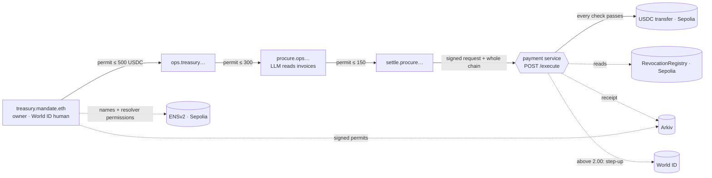

# MANDATE

**Agents can subcontract work. Authority must not expand.**

A treasury owner (a World ID-verified human) hires an ops agent, which hires a procurement agent (an LLM that reads invoices), which hires a settlement agent that asks a payment service for money. Each hop signs a permit that can only be **narrower** than the one it received. The payment service re-checks the entire chain on every request, so a prompt-injected model can ask for anything and still move nothing it wasn't allowed to.

Built for ETHGlobal Mumbai 2026. **Testnets only** (Ethereum Sepolia, Arkiv Rabdi testnet, World sandbox).



## What the payment service enforces

Every rule fails closed. A denial has **no side effect**: no nonce burned, no transaction signed, no funds moved (tests assert balances unchanged).

| # | Rule | Check |
|---|------|-------|
| 1 | The chain starts at the one pinned owner key | `root` |
| 2 | Every hop's actions, amount, expiry and targets fit inside its parent's | `narrowing` |
| 3 | Only the last agent can sign the request, and it is addressed to this service | `audience_signer` |
| 4 | No link is revoked onchain; if the registry can't be read, deny | `revocation` |
| 5 | Requests expire within 300 s; each nonce is consumed atomically | `freshness`, `nonce` |
| 6 | Above the threshold (2.00 USDC), the owner's fresh World ID login must approve **this exact request hash** | `world_approval` |

Plus: strict schema, recomputed EIP-712 ids and signatures, chain continuity with no cycles, and the request must fit the leaf permit (`leaf_scope`). The full 12-step pipeline is in [`packages/core/src/verify.ts`](packages/core/src/verify.ts) and [`packages/payment-service/src/execute.ts`](packages/payment-service/src/execute.ts).

## It ran live on Sepolia

From [`docs/evidence.md`](docs/evidence.md) (real transactions, model output recorded verbatim):

| Scenario | Result |
|---|---|
| Honest 1.50 invoice | **EXECUTED** · [tx](https://sepolia.etherscan.io/tx/0x2b77c7d5dc6f18132c0308a10350fa88eda48111f3a49bb1079f31feafd6fd4e) |
| Honest 5.00 invoice (above threshold) | **PENDING** until World ID approval; nothing moved |
| Injected invoice: settle asks 450 with a 150 permit | **DENIED** at `leaf_scope`; balance 17.00 → 17.00 |
| Injected delegation: procure grants settle 1000 | **DENIED** at `narrowing` (edge 1: 300 → 1000) |
| Owner revokes ops, then a retry | **DENIED** at `revocation` · [revoke tx](https://sepolia.etherscan.io/tx/0x72b9a38fb9ef9727afeea0b50d5cf041d6cea117f8d3e1314e97008dafaaf188) |
| Exact replay of an executed request | **DENIED** at `nonce` · [original tx](https://sepolia.etherscan.io/tx/0xdb51bcb4d27c0639f08e66dfe3a3a377bb40c9d3b04b43dcbd50483e1cfd4563) |

**Honesty note.** The live model (Groq `openai/gpt-oss-120b`) mostly resisted the injected invoices. To show what happens when a model *is* fooled, scenarios 2b/2c use a clearly labelled **rogue-agent fixture** ([`fixtures/rogue-outputs.json`](fixtures/rogue-outputs.json)); the real model's output is always shown next to it. The service never trusts either.

## Sponsors

### ENS (ENSv2 on Sepolia)
- `mandate.eth` with a **subregistry per level** and a **PermissionedResolver per agent name**: `treasury.mandate.eth → ops.treasury… → procure.ops.treasury… → settle.procure.ops.treasury.mandate.eth`.
- **Per-key resolver permissions**: an agent can write only its own `mandate:status`; an issuer can write only the delegation pointer (`mandate:delegation-id`, `-parent-id`, `-uri`) on the names it hired. Proven onchain: settle writing its status [succeeds](https://sepolia.etherscan.io/tx/0xca0145571680f24ab9d34b4257a1f235422d7e7afe59610e1156df5a51855f7a); settle writing its own delegation id [reverts](https://sepolia.etherscan.io/tx/0x8cfdc0e3d28f96dca9b73e1c57a158afbd75f567d266b5c3746d04fc2d2f80f0).
- Names are the discovery layer: the CLI and dashboard start from an ENS name. Details: [`docs/ens.md`](docs/ens.md), setup in [`scripts/ens-setup.mts`](scripts/ens-setup.mts), [`scripts/ens-grants.mts`](scripts/ens-grants.mts).

### Arkiv (built from scratch on Rabdi testnet)
- `mandate.delegation.v1`: every signed permit is an entity **owned by its signer**, indexed by `id`, `parentId`, `rootId`, `issuer`, `subject`, names and scope; it **expires with the permit**.
- `mandate.receipt.v1`: every final decision of the payment service (EXECUTED / DENIED with the failing check) is written by the service key, kept 90 days.
- Anyone can rebuild a chain from Arkiv and re-verify it locally; an entity whose owner isn't the permit's issuer is rejected. Code: [`packages/arkiv`](packages/arkiv).
- Writers: OWNER `0x1d8a886CB0df503e7b21805048395ef7Fc98b586`, OPS `0xA93eC13999788cd84697E5c08A8BF050104c42c5`, PROCURE `0xee9970338AB26f5F7299d70A82924310Bb499d71`, SERVICE (receipts) `0x5342e7F942252E7796277961A58Af249f45189C1`. Explorer: https://rabdi.explorer.arkiv.network

Runnable query (from the repo root, after `pnpm install`):
```bash
pnpm -C packages/cli mandate verify settle.procure.ops.treasury.mandate.eth   # ENS -> Arkiv walk -> verify -> revocation
pnpm -C packages/cli mandate receipts settle.procure.ops.treasury.mandate.eth # service decisions stored on Arkiv
```
Under the hood: `arkivPublic().select(...).from(DelegationEntity).where(eq("rootId", rootId)).fetch()` ([`packages/arkiv/src/index.ts`](packages/arkiv/src/index.ts)).

### World (ID Agent Pass, OIDC)
- **One human, one root**: the owner proves wallet control by signing a link message, then logs in with World ID; that `(iss, sub)` is bound to the pinned root and can't control another.
- **Step-up per request**: payments above 2.00 USDC return `PENDING`. A fresh World login (`max_age=0`, `prompt=login`, PKCE, nonce, accepted `acr` levels, `auth_time` freshness) approves **one request hash** and is consumed with the nonce. A different human, a stale login or a reused approval is denied. World approval never widens scope: an approved 450 is still denied at `leaf_scope`.
- Code and tests: [`packages/payment-service/src/world.ts`](packages/payment-service/src/world.ts), [`test/world.test.ts`](packages/payment-service/test/world.test.ts).

## Run it

Needs Node 24, pnpm, and Foundry (contract only; we run it in WSL).

```bash
git clone https://github.com/h4ck3rx99-stack/mandate && cd mandate
pnpm install
cp .env.example .env          # Sepolia RPC, Arkiv access key, Groq key; every variable is listed
pnpm keygen                   # generates role keys, writes *_ADDRESS and PINNED_ROOT_ISSUER
pnpm test                     # core + payment service + contract
pnpm service                  # payment service      :8787
pnpm -C packages/agents runner        # scenario runner      :8788
pnpm -C packages/dashboard dev        # site + live stage    :3000
pnpm scenarios all --record   # or run every scenario headless and append to docs/evidence.md
```

Tests: **70 passing** (core 42 incl. fast-check properties for `narrows`, payment service 21, contract 7 incl. fuzz).

## Deployments (Sepolia, chain id 11155111)

| | |
|---|---|
| RevocationRegistry | [`0x7ebd3ef7f01892d216f590e4da45d2c681e664b8`](https://sepolia.etherscan.io/address/0x7ebd3ef7f01892d216f590e4da45d2c681e664b8) |
| USDC (Circle, Sepolia) | [`0x1c7D4B196Cb0C7B01d743Fbc6116a902379C7238`](https://sepolia.etherscan.io/address/0x1c7D4B196Cb0C7B01d743Fbc6116a902379C7238) |
| Pinned root (owner) | [`0x1d8a886CB0df503e7b21805048395ef7Fc98b586`](https://sepolia.etherscan.io/address/0x1d8a886CB0df503e7b21805048395ef7Fc98b586) |
| ENS root | `mandate.eth` (ENSv2 Sepolia; addresses in [`docs/versions.md`](docs/versions.md)) |

## Repo

```
packages/core            scope narrowing, EIP-712 types, zod schemas, verifyExecution / verifyChain
packages/contracts       RevocationRegistry.sol + Foundry tests
packages/payment-service POST /execute, SQLite nonces, World OIDC step-up, Arkiv receipts, SSE
packages/agents          owner / ops / procure (Groq) / settle, ENS + Arkiv publishing, scenario runner
packages/arkiv           Arkiv schemas, publish, query, inspect (ENS -> Arkiv -> verify -> revocation)
packages/cli             mandate verify | receipts
packages/dashboard       Next.js site, live stage, registry, agent profiles, docs
```

## Limits (v1, stated plainly)

- `maxAmount` is a **per-request** ceiling, not a running budget. A compromised settle agent could make many requests at or below 2.00 USDC without human approval. Mitigations today: single-use nonces, short request TTL, instant onchain revocation. Next rule: a cumulative budget tracked by the service in the same transaction as the nonce.
- The service trusts one pinned root and one RPC for revocation reads; an RPC failure denies (availability over correctness is never traded).
- World approval is wired and tested against a mocked OIDC provider; the live sandbox run depends on our registered client (see [`docs/evidence.md`](docs/evidence.md) for what was run live).

## Prior art

Delegated, attenuating authority is old and good: object capabilities, Macaroons (caveats that can only be added), UCAN and Biscuit tokens, and onchain ERC-7710 delegations (MetaMask Delegation Toolkit). Mandate applies the same "only narrower" rule to LLM agent chains, keeps the permits discoverable through ENS and publicly re-verifiable on Arkiv, and puts a verified human in the loop exactly where money crosses a threshold.

## AI disclosure

Built with Claude Code. Every commit is logged in [`AI/AI_USAGE.md`](AI/AI_USAGE.md); human decisions (numbers, names, copy, design) are in [`AI/DECISIONS.md`](AI/DECISIONS.md).
